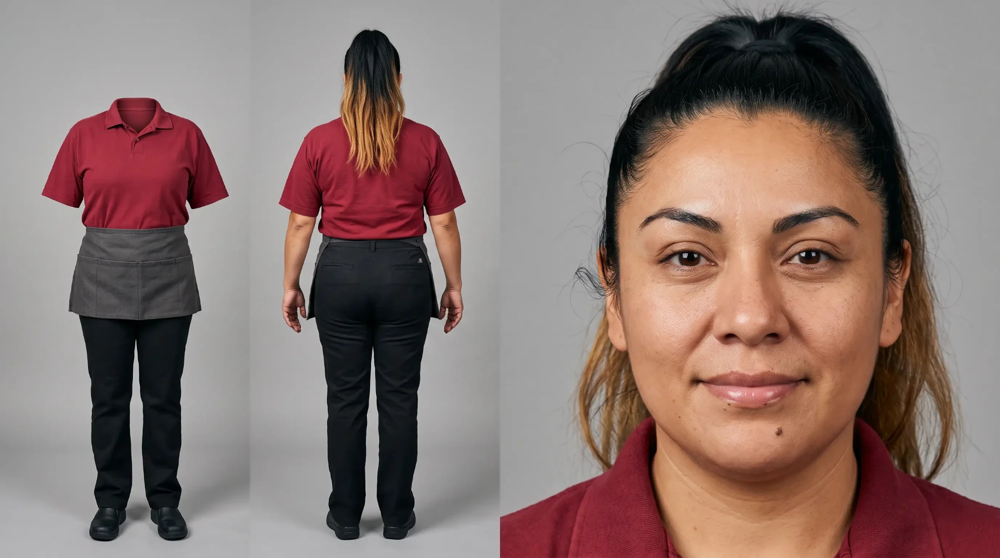
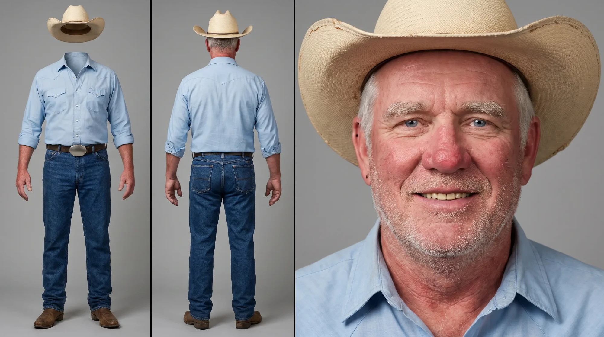
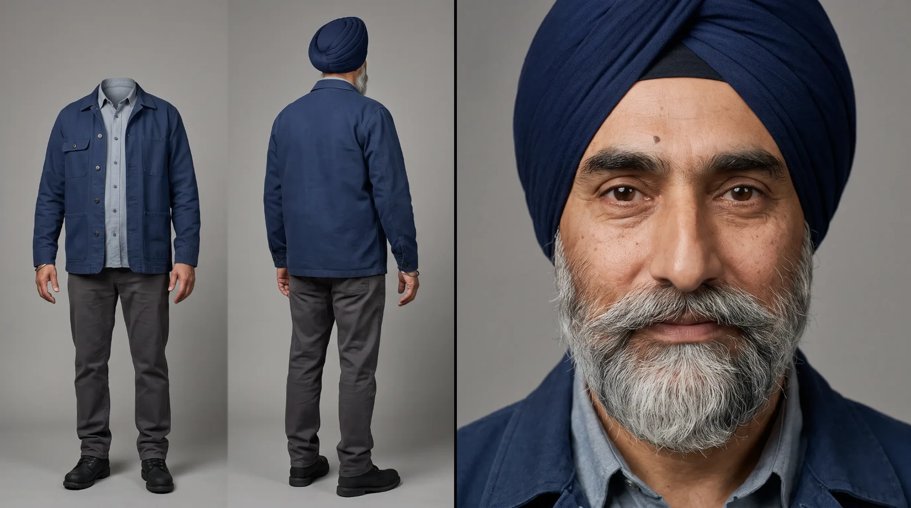
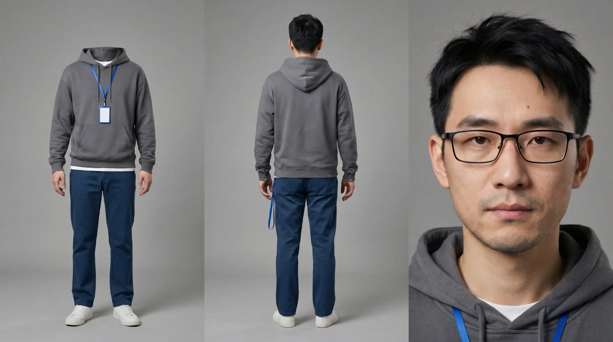

# character-sheet · 一句话生成写实人物三视图

**说一句人设，就能拿到一张超写实的人物三视图。**

这是一个 [Claude Code](https://claude.com/claude-code) 技能（skill）。你只要说"35 岁拉丁裔女性加油站店员"这样一句话，它就写出一条完整的提示词，丢进 Nano Banana Pro 直接文生图，不需要参考图、不需要会写提示词，出来就是电影肖像级的真人质感三视图。

> **English summary:** One sentence in, a photoreal character sheet out. Describe a character in a single line (e.g. "35-year-old Latina gas station clerk") and this Claude Code skill writes a complete text-to-image prompt for Nano Banana Pro — no reference image, no prompt-writing skills needed. Output: a head-and-shoulders close-up plus front (invisible mannequin) and back full-body views, in a cinematic hyperreal style. Prompts are written in Chinese.

## 一句话 → 提示词 → 出图

**① 你说的话**

```
35 岁拉丁裔女性加油站店员
```

**② 技能写出的提示词**（复制进 Nano Banana Pro，比例 16:9）

```
生成人物三视图。
人物：一位 35 岁的墨西哥裔美国女性加油站便利店店员，身材中等偏丰满，肩膀圆润。鹅蛋脸偏圆，颧骨饱满，额头中等，发际线整齐，眉骨平缓；眉毛浓黑，弧度自然，眉尾略细；深棕色杏仁眼，眼角有浅浅的细纹，额头几乎没有抬头纹；鼻梁中等，鼻头圆润，鼻翼略宽，没有晒红；嘴唇饱满，只涂了透明润唇膏，嘴角自然微扬，法令纹浅；下颌线柔和，下巴圆润；黑色浓密长直发扎成高马尾，发尾带已经长出黑色发根的焦糖色挑染，两鬓没有白发，额角有几缕碎发；下唇右下方有一颗深棕色小痣作为辨识特征。皮肤为暖橄榄色，鼻翼毛孔明显，纹理真实，有轻微眼袋。原创面孔，不像任何真实名人。
服装：不戴帽子，深红色翻领短袖棉质工作衫（无品牌标），外系一条深灰色帆布半身工作围裙（无品牌标），黑色直筒工作长裤，黑色防滑工作鞋。衣物和帽子上没有任何品牌标志或文字。
主体（右侧面板——头部特写）： 头部和肩部特写，表情自然放松，与左侧背面全身照为同一人，发型、发色、肤色、头型和体型完全一致，无任何偏差；面部严格按上述人物描述生成。双手和手臂未出现在画面中——干净利落的头部和肩部特写，双手未靠近面部或肩膀。
左侧面板——生成正面全身照和背面全身照。 从头顶到鞋底完整入镜，头顶和脚底留有适当空间。
需要注意的是：正面全身照是隐形模特（服装悬浮/摆放成穿着效果，重点是无头部，但有四肢，有手，手有五指）。
背面全身照有头部，有肢体，有手，手有五指。 三个面板的衣物样式完全一致，与上述服装描述100%匹配。尺码适合身高约163厘米的女人。
布局：人物设定图分割构图。
背景与光线：无缝中性灰影棚背景。均匀柔和的中性影棚灯光，曝光均衡，无生硬阴影，白平衡约为5500K。
风格：皮肤真实细腻，电影肖像，超写实人脸，纪录片摄影风格、RAW格式质感，自然肤质可见毛孔和细小汗毛，不完美肌理，虹膜纤维清晰、眼睛湿润有真实反光、睫毛根根分明，浓黑的自然弧形眉，眉尾略细，有少量新长出的杂毛、唇部纹理细致，自然阴影过渡，人像摄影、45mm镜头、f/2.8光圈、全画幅相机、细腻微对比、真实色彩科学、柔和胶片颗粒、未经磨皮滤镜、自然面部结构、真实发丝和胡茬细节、克制色彩、宽容度高、眼部焦点极其锐利、自然解剖准确、无美颜滤镜、博物馆级人像、获奖级编辑摄影。
肤质细节：暖橄榄色皮肤，T 区和鼻翼有轻微出油反光；眼下有长期值夜班留下的淡青色暗沉；侧光下脸颊和上唇细小汗毛可见；下唇右下方小痣颜色深棕、略微凸起、边缘清晰。
毛发细节：高马尾发丝浓密有光泽，被发圈勒出自然弧度；发尾焦糖色挑染，上方约 3 厘米已长出黑色发根；额角和耳后有几缕碎发自然翘起。
服装质感：工作衫棉质纹理清晰，领口略微变形，腋下和腰侧有细褶；围裙下摆有洗不掉的淡色污渍，系带边缘起毛；长裤膝盖处轻微鼓包；防滑工作鞋鞋头有擦痕，鞋底边缘沾灰。
面部瑕疵真实可见。
```

**③ 出图**



## 更多出图效果

都是一句话人设、一条提示词、一次直接出图，没有用参考图。

**德州老牛仔 · 55 岁**


**锡克族卡车司机 · 50 岁**


**东亚上班族**


## 为什么好用

- **一句话就够**：只需要角色是谁。年龄、族裔、服装方向等缺了才问，其余全部给合理默认值。
- **真写实，不是"AI 脸"**：电影肖像式超写实风格，写到毛孔、汗毛、虹膜纤维、眼袋、晒斑；再按角色单独补肤质、毛发、服装磨损三行细节，杜绝磨皮感和塑料感。
- **面部描写极细**：按"脸型 → 额头 → 眉 → 眼 → 皱纹 → 鼻 → 唇 → 下颌 → 胡须 → 发型 → 辨识特征 → 肤色"的固定顺序写，每张脸都有自己的样子。
- **原创面孔**：固定写明"不像任何真实名人"，衣服帽子上也不出现品牌标志。
- **出图稳定**：固定模板逐字照搬，只换角色信息，版式和画质每次都一样。
- **附验收清单和翻车对策**：版式跑偏、隐形模特长出头、自动加文字标签等，都有对应改法。

### 附带好处：人物一致性

一张图里同时给出三个面板，拿去做后续分镜、短片时可以当角色参考：

| 位置 | 内容 | 用途 |
|---|---|---|
| 右侧 | 头部和肩部特写 | 锁定脸 |
| 左侧 | 正面全身照（隐形模特，无头，有手） | 锁定服装正面 |
| 左侧 | 背面全身照（有头） | 锁定发型、肤色、体型 |

每个角色只给一个辨识特征（一颗痣、一道小疤），避免细节在不同面板间漂移。

## 安装

把整个文件夹放到 Claude Code 的个人技能目录里：

```bash
git clone https://github.com/likunru-oss/character-sheet-skill.git ~/.claude/skills/character-sheet
```

重新打开 Claude Code 后自动生效。

## 使用

直接用中文说一句人设就会触发，例如：

- "35 岁拉丁裔女性加油站店员"
- "帮我做一个人物三视图：60 岁退休消防员"
- "给主角出 3 个人设方案"

## 文件结构

```
character-sheet/
├── SKILL.md                 # 技能主体：输入收集、固定模板、写法规则、验收清单、翻车对策
├── references/
│   └── examples.md          # 8 个完整提示词示例（不同年龄、族裔、性别）
└── images/                  # README 里的出图效果
```

## 注意

- 所有角色都是原创面孔，请不要用它模仿真实人物。
- 推荐比例 16:9，文件命名 `C-<编号>-sheet.png`。

## 特别鸣谢

感谢 **昆汀狗**、**马鲛**、**开心鬼** 对这套模板的打磨与支持。
